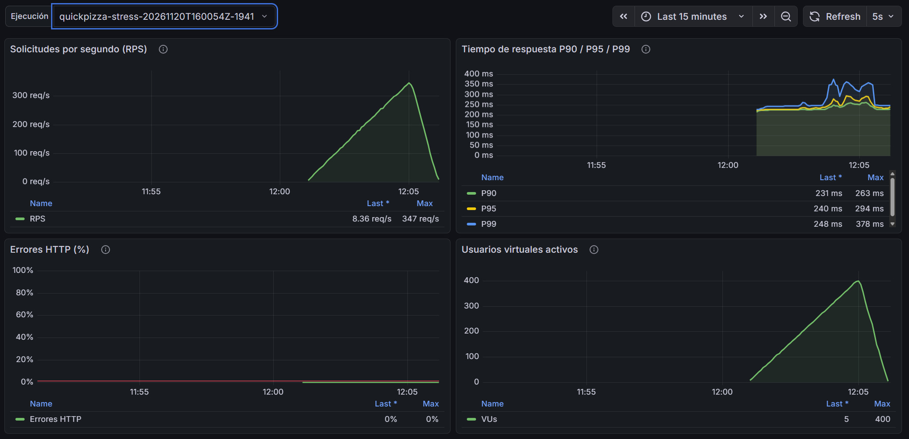

# QuickPizza – Pruebas de Performance con k6

Proyecto final del **Diplomado en Testing de Software V6 (UCB)** – Módulo Testing de Performance.

Evaluación de rendimiento de la aplicación de demostración **QuickPizza** de Grafana mediante **Grafana k6 Studio**, **k6** y **Grafana**.

- **App bajo prueba:** https://quickpizza.grafana.com
- **Herramientas:** Grafana k6 Studio 2.1.3 · k6 · Prometheus · Grafana

---

## 📊 Resultados

| Prueba | Usuarios | P95 | P99 | Errores | Checks | Resultado |
|---|---:|---:|---:|---:|---:|:---:|
| Smoke  | 1   | 223 ms | 236 ms | 0 % | 100 %   | ✅ |
| Load   | 100 | 226 ms | 237 ms | 0 % | 99.99 % | ✅ |
| Spike  | 100 | 227 ms | 237 ms | 0 % | 99.99 % | ✅ |
| Stress | 400 | 254 ms | 323 ms | 0 % | 99.95 % | ✅ |

> **Conclusión:** QuickPizza soporta unos **300 usuarios simultáneos** respondiendo en ~230 ms y sin errores. Desde ahí, las acciones que guardan datos (pedir y calificar pizzas) son las primeras en ponerse lentas.



*Dashboard de Grafana durante el stress de 400 usuarios (k6 → Prometheus → Grafana, sin Docker).*

---

## Escenario de negocio

Se modela el comportamiento de un usuario que ingresa a QuickPizza, inicia sesión, solicita pizzas y registra una valoración.

El flujo implementado es:

1. **HomePage:** abre la página principal.
2. **Login:** obtiene el `csrf_token` e inicia sesión.
3. **Pedir pizza 1:** solicita una pizza mediante *Pizza, Please!*.
4. **Calificar pizza 1:** selecciona aleatoriamente entre:
   - **Love it:** 5 estrellas.
   - **No thanks:** 1 estrella.
5. **Pedir pizza 2:** solicita una segunda pizza.
6. **Calificar pizza 2:** selecciona aleatoriamente entre:
   - **Love it:** 5 estrellas.
   - **No thanks:** 1 estrella.

La distribución de las valoraciones está parametrizada para representar aproximadamente un comportamiento de **80 % Love it / 20 % No thanks**.

---

## Estructura del proyecto

```text
quickpizza-performance-k6/
├── config/
│   └── settings.js                  # URL base, think time y modo DEBUG
├── data/
│   ├── users.csv                    # Credenciales
│   └── pizzas.csv                   # 30 pizzas para parametrización
├── utils/
│   ├── csv.js                       # Lector de archivos CSV
│   ├── data.js                      # SharedArray de usuarios y pizzas
│   ├── http.js                      # Cabeceras y token anónimo dinámico
│   ├── auth.js                      # CSRF, login y autenticación
│   └── checks.js                    # Checks de tiempo por endpoint
├── scenarios/
│   └── orderPizza.js                # Flujo de negocio
├── scripts/
│   ├── quickpizza-v2-correlacion.js # Correlaciones
│   ├── quickpizza-v3-modular.js     # Versión modular
│   ├── quickpizza-v5-smoke.js       # Prueba Smoke
│   ├── quickpizza-v5-load.js        # Prueba Load
│   ├── quickpizza-v5-spike.js       # Prueba Spike
│   ├── quickpizza-v5-stress.js      # Prueba Stress
│   ├── run-grafana.ps1              # Ejecución con Grafana (PowerShell)
│   └── run-grafana.sh               # Ejecución con Grafana (Bash)
├── observability/
│   ├── prometheus.yml               # Configuración de Prometheus
│   └── quickpizza-dashboard.json    # Dashboard de Grafana
├── reports/                         # Reportes HTML y salidas de consola
├── docs/
│   ├── grafana-sin-docker.md        # Guía de Grafana sin Docker
│   └── images/                      # Capturas
└── README.md
```

---

# Versiones del proyecto

| Versión | Descripción | Estado |
|---|---|---|
| **v1** | Script generado automáticamente por k6 Studio mediante grabación y asistente | ✅ |
| **v2** | Correlaciones de `csrf_token`, sesión y `pizza_id` | ✅ |
| **v3** | Estructura modular + parametrización mediante **SharedArray** y archivos CSV + think time + hasta 100 VUs | ✅ |
| **v4** | Checks de negocio + comportamiento probabilístico 80 % *Love it* / 20 % *No thanks* | ✅ |
| **v5** | Thresholds + perfiles de carga: smoke, load, spike y stress | ✅ |
| **v6** | Checks de tiempos + métricas hacia Prometheus y Grafana local + dashboard | ✅ |

---

# v1 – Grabación inicial

La primera versión fue generada mediante **Grafana k6 Studio**, utilizando la grabación del flujo de negocio.

Esta versión permitió obtener una primera automatización del recorrido:

```text
HomePage
   ↓
Login
   ↓
Pedir pizza
   ↓
Calificar
   ↓
Pedir otra pizza
   ↓
Calificar
```

La grabación sirvió como punto de partida para posteriormente analizar las solicitudes y corregir los valores dinámicos del flujo.

---

# v2 – Correlación

En la segunda versión se analizaron los valores dinámicos utilizados durante la ejecución.

### Hallazgos

- El asistente de k6 Studio detectó automáticamente la correlación del **`csrf_token`**.
- No detectó correctamente la correlación del **`pizza_id`**.
- Las solicitudes de valoración (`POST /api/ratings`) fallaban con **HTTP 400**.
- El `pizza_id` era enviado como texto en lugar de un valor numérico.

El servidor devolvía:

```text
cannot unmarshal string into Go struct field Rating.pizza_id of type int64
```

### Solución

Se implementó:

- Extractor JSON sobre `pizza.id`.
- Reemplazo del valor utilizando el modo **Begin-End**.
- Envío del `pizza_id` como número, sin comillas.

Con esta modificación, la solicitud de valoración pudo procesarse correctamente.

---

# v3 – Modularización y parametrización

La tercera versión reorganizó el proyecto para separar responsabilidades y facilitar el mantenimiento del código.

### Implementaciones principales

- Uso de **SharedArray** para los datos de prueba.
- Parametrización mediante archivos CSV.
- Separación de:
  - configuración,
  - datos,
  - autenticación,
  - utilidades HTTP,
  - flujo de negocio.
- Think time entre acciones.
- Ejecución con hasta **100 VUs**.
- Correlación de valores dinámicos durante la ejecución.

### Correcciones realizadas

#### Pizza incorrecta en la valoración

Cada pizza creada durante la iteración guarda su propio `pizza.id`, evitando utilizar accidentalmente el ID de otra pizza.

#### Solicitudes duplicadas

La grabación inicial contenía solicitudes duplicadas de `POST /api/pizza`.

Estas solicitudes provocaban que una iteración generara más pizzas de las necesarias y alteraban artificialmente el volumen de tráfico.

Se eliminaron las solicitudes duplicadas.

#### Tokens fijos

La grabación contenía valores fijos para determinados tokens y headers.

Se reemplazaron por valores dinámicos:

- Token anónimo generado durante la ejecución.
- Token de sesión obtenido mediante correlación después del login.

#### Usuario de prueba

El entorno público presentó comportamientos inconsistentes al utilizar usuarios registrados específicamente para las pruebas.

Por este motivo se utiliza el usuario `default`, disponible en el entorno de QuickPizza y almacenado en:

```text
data/users.csv
```

El login se ejecuta como parte del flujo completo de cada iteración.

#### Extracción robusta del cookie

Se agregó validación antes de procesar el header `Set-Cookie`, evitando que la iteración falle cuando el valor no esté disponible.

---

# Correlaciones implementadas

| # | Valor | Origen | Técnica | Uso |
|---|---|---|---|---|
| 1 | `csrf_token` | Header `Set-Cookie` de `POST /api/csrf-token` | Regex `csrf_token=([A-Za-z0-9]+);` | Body del login |
| 2 | `token` de sesión | Body de `POST /api/users/token/login` | JSONPath `token` | Header `Authorization` |
| 3 | `pizza.id` | Body de `POST /api/pizza` | JSONPath `pizza.id` | Body de `POST /api/ratings` |

---

# v4 – Checks de negocio y comportamiento del usuario

La cuarta versión incorpora validaciones funcionales mediante **checks de k6** y agrega comportamiento probabilístico para las valoraciones.

## Checks implementados

Durante el flujo se validan:

- Status HTTP de HomePage.
- Status HTTP de Login.
- Obtención del CSRF.
- Extracción del CSRF.
- Login exitoso.
- Longitud del token de sesión.
- Usuario autenticado.
- Creación de la pizza.
- Existencia del `pizza.id`.
- Creación correcta de la valoración.

La valoración espera una respuesta:

```text
HTTP 201 Created
```

## Distribución de comportamiento

Cada valoración selecciona aleatoriamente entre:

```text
80 % → Love it → 5 estrellas
20 % → No thanks → 1 estrella
```

La distribución busca representar un comportamiento de usuario más realista durante las pruebas de carga.

---

# v5 – Perfiles de carga

La quinta versión incorpora **thresholds** y diferentes perfiles de carga para evaluar el comportamiento de QuickPizza bajo distintas condiciones.

## Criterios de aceptación

Se definieron los siguientes objetivos de rendimiento para el proyecto:

```text
P95 < 500 ms
Error rate < 1 %
```

Los criterios se implementan mediante thresholds de k6:

```js
thresholds: {
  http_req_duration: ["p(95)<500"],
  http_req_failed: ["rate<0.01"],
}
```

El valor de **500 ms** se utiliza como criterio de aceptación definido para este proyecto, tomando como referencia el objetivo de rendimiento planteado en la consigna.

---

## v5.1 – Smoke

Objetivo: validar rápidamente que el flujo completo funciona correctamente antes de ejecutar pruebas de mayor carga.

Configuración:

```text
1 VU
1 iteración
```

---

## v5.2 – Load

Objetivo: evaluar el comportamiento de la aplicación bajo una carga sostenida.

Perfil:

```text
100 VUs → 1 minuto
100 VUs → 3 minutos
0 VUs   → 1 minuto
```

---

## v5.3 – Spike

Objetivo: evaluar la reacción de la aplicación ante un aumento brusco de usuarios.

Perfil:

```text
10 VUs  → 30 segundos
100 VUs → 10 segundos
100 VUs → 1 minuto
0 VUs   → 30 segundos
```

---

## v5.4 – Stress

Objetivo: incrementar progresivamente la carga para observar posibles signos de degradación.

Perfil:

```text
100 VUs → 1 minuto
200 VUs → 1 minuto
300 VUs → 1 minuto
400 VUs → 1 minuto
0 VUs   → 1 minuto
```

El resumen de resultados de estos escenarios está en la sección [📊 Resultados](#-resultados).

---

# v6 – Observabilidad con Grafana

Los checks de tiempo validan cada solicitud del flujo modular contra un límite de 500 ms, configurable con `MAX_RESPONSE_MS`. Los thresholds de v5 mantienen P95 < 500 ms y errores HTTP < 1 %.

La integración utiliza k6 → Prometheus → Grafana mediante remote write e histogramas nativos, con instalación local de los ejecutables.

- Dashboard importable en `observability/quickpizza-dashboard.json`.
- Paneles de RPS, P90/P95/P99, errores HTTP, VUs y checks de tiempo por endpoint.
- Runners para PowerShell (`scripts/run-grafana.ps1`) y Bash (`scripts/run-grafana.sh`).
- Filtro por identificador único de ejecución y resumen JSON en `reports/`.

Consultar la [guía de instalación y ejecución sin Docker](docs/grafana-sin-docker.md).

---

# Cómo ejecutar

## Requisitos

- **k6** instalado.
- Verificar la instalación:

```bash
k6 version
```

- Opcionalmente, **Grafana k6 Studio 2.1.3** para abrir y editar las grabaciones.

---

## Ejecutar Smoke

```bash
k6 run scripts/quickpizza-v5-smoke.js
```

---

## Ejecutar Load

```bash
k6 run scripts/quickpizza-v5-load.js
```

---

## Ejecutar Spike

```bash
k6 run scripts/quickpizza-v5-spike.js
```

---

## Ejecutar Stress

```bash
k6 run scripts/quickpizza-v5-stress.js
```

---

## Ver las correlaciones en modo debug

Para visualizar durante la ejecución los valores dinámicos capturados:

```bash
k6 run -e DEBUG=true --vus 1 --iterations 2 scripts/quickpizza-v3-modular.js
```

Esto permite observar valores como:

- `csrf_token`
- token de sesión
- `pizza.id`

---

## Dashboard web local de k6

k6 también permite visualizar las métricas mediante su dashboard web incorporado.

### PowerShell

```powershell
$env:K6_WEB_DASHBOARD="true"
$env:K6_WEB_DASHBOARD_EXPORT="reports/reporte.html"
k6 run scripts/quickpizza-v5-load.js
```

Dashboard:

```text
http://localhost:5665
```

> Este dashboard corresponde a la funcionalidad web integrada de k6. Para abrir el dashboard de Grafana local, seguir la [guía de v6](docs/grafana-sin-docker.md).

---

## Cambiar la URL de la aplicación

La URL base puede modificarse mediante la variable de entorno `BASE_URL`:

```bash
k6 run -e BASE_URL=http://localhost:3333 scripts/quickpizza-v5-load.js
```

---

# Consideraciones sobre el entorno

`quickpizza.grafana.com` es un entorno **público y compartido** proporcionado por Grafana para realizar prácticas de testing de performance.

Por este motivo:

- Las pruebas se mantienen acotadas.
- Se utiliza *think time* entre acciones.
- Se evita realizar cargas innecesariamente prolongadas.
- Los resultados deben interpretarse considerando que se trata de un entorno compartido.

---

# Documentación y evidencias

- `reports/`: reportes HTML del dashboard web de k6 y salidas de consola.
- `observability/`: dashboard de Grafana y configuración de Prometheus.
- `docs/grafana-sin-docker.md`: guía para instalar y ejecutar Grafana sin Docker.
- `docs/images/`: capturas usadas en este README.

---

# Equipo – Grupo 2

- Pablo Ivan Chuquimia Huanca
- Mauricio Gutierrez Pacheco
- Rodrigo Camilo Mendez Gallardo
- Maria Alexandra Quintanilla
- Pedro Adrian Santos Orellana
- David Soliz Garcia

**Docente:** Marco Luna Gonzales